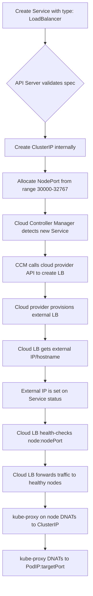
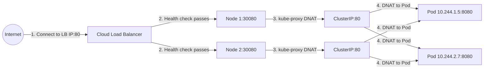
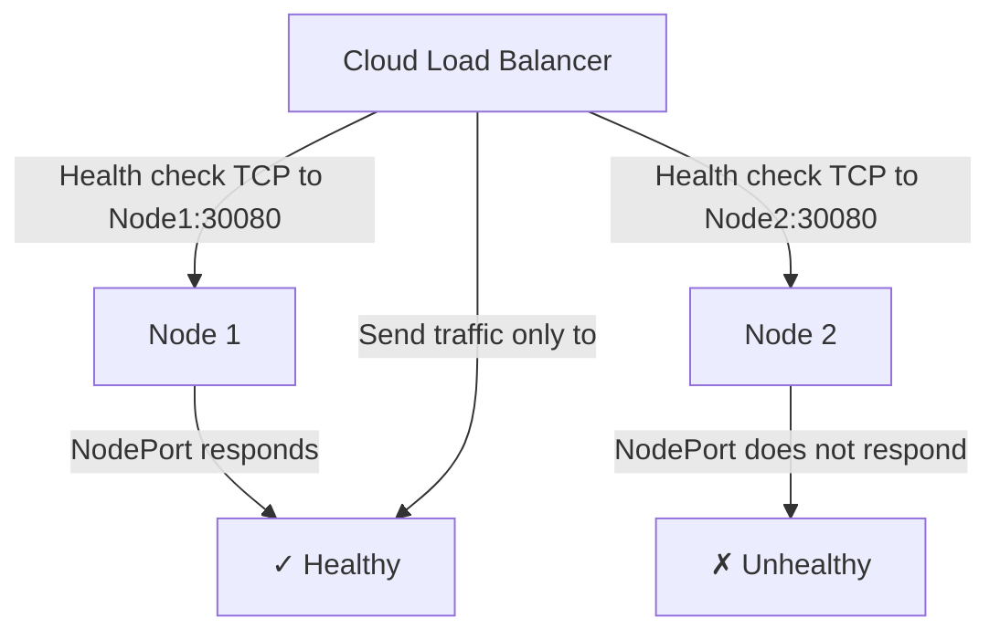

# Services - LoadBalancer - Core Mechanics

## What Is a LoadBalancer Service?

A LoadBalancer Service provisions an **external load balancer** managed by the cloud provider that distributes incoming traffic across the **nodes** in the cluster. Unlike NodePort — which exposes Pods on a high port range (30000–32767) and requires clients to connect to a specific node IP — a LoadBalancer gives you a single stable external IP or DNS name and lets you use **standard ports** like 80 or 8080.

Because the external IP is owned by the cloud provider (not by any individual node), if a node goes down the cloud's health checks automatically stop routing traffic to it — your customers never lose the IP or DNS name. The cloud LB performs **health checks** against each node. When `externalTrafficPolicy: Local` is set, kube-proxy serves an HTTP health-check endpoint (the per-Service `healthCheckNodePort`) that returns **200** if at least one matching Pod exists on the node, or **503** if none do. The cloud LB uses these responses to exclude nodes without local Pods from the rotation entirely, avoiding the silent packet drops (no response at all) that can occur with NodePort when no Pods are running on a node.

At creation you receive an **ephemeral IP** that is stable for the lifetime of the Service, but the cloud may recycle it if the Service is deleted. You can request a **static IP** from the cloud console or via cloud provider annotations to guarantee permanence.

A LoadBalancer is still fundamentally a Kubernetes Service: it routes traffic only to Pods whose labels match its `selector`, meaning in theory one LoadBalancer per Deployment. Since each LoadBalancer incurs cloud costs, the common pattern is to attach a single LoadBalancer to an Ingress Controller Deployment and let the controller route to multiple Services.

The LoadBalancer Service type extends NodePort by asking the cloud provider to provision an external load balancer that forwards traffic to the nodePort on each node. This is the standard way to expose Kubernetes workloads in cloud environments.

## How LoadBalancer Works

When you create a Service of type `LoadBalancer`, the Kubernetes control plane performs the following steps:



## The Cloud Controller Manager (CCM)

The Cloud Controller Manager is the component responsible for integrating Kubernetes with cloud providers. It runs as a pod in the `kube-system` namespace and handles:

- **Node discovery**: Identifying nodes in the cloud and their properties.
- **Route management**: Setting up cloud networking routes.
- **Service management**: Creating and deleting cloud load balancers for LoadBalancer Services.

```bash
# Check if CCM is running
kubectl get pods -n kube-system | grep cloud-controller

# Check CCM logs for LoadBalancer-related activity
kubectl logs -n kube-system deployment/cloud-controller-manager | grep -i "loadbalancer\|service"

# Check the cloud provider configuration on the API server
ps aux | grep kube-apiserver | grep cloud-provider
```

## Step-by-Step Traffic Flow



### Step 1: Client connects to the cloud load balancer's external IP.
The cloud LB has a static (or ephemeral) external IP assigned by the cloud provider.

### Step 2: The cloud LB performs health checks on each node's nodePort.
If a node's nodePort is not responding (e.g., no healthy Pods on that node), the cloud LB stops sending traffic to that node.

### Step 3: The cloud LB forwards traffic to a healthy node's nodePort.
kube-proxy on that node intercepts the traffic and DNATs it to the ClusterIP.

### Step 4: kube-proxy DNATs the traffic to a backend Pod.
The Pod receives the request, processes it, and sends the response back through the same path.

## Deep Dive: The Full Chain of Events

The complete packet flow — from the external load balancer down to the application Pod — spans several layers. Here is how each component contributes:

### External LB → Entry Node (NodePort)

The cloud's external load balancer selects a **random healthy node** as the entry point (any node whose nodePort TCP health check succeeds). It forwards the packet to `NodeIP:nodePort` (e.g. `10.0.1.5:32080`). Creating a NodePort instructs kube-proxy on every node to intercept packets destined for that port — as if they were destined for the Service's ClusterIP — and DNAT them to `ClusterIP:servicePort`.

### kube-proxy → ClusterIP → Pod IP

On the entry node, kube-proxy consults the **EndpointSlices** associated with the Service. EndpointSlices list the ready Pod IPs and ports for each backend. kube-proxy selects a Pod IP and DNATs the packet to `PodIP:targetPort`. Pod IPs are unique across the entire cluster; for example, with a pod CIDR of `10.1.0.0/16`, each node might receive a `/24` slice (`10.1.1.0/24`, `10.1.2.0/24`, …) from which Pod IPs are allocated.

When `externalTrafficPolicy` is `Cluster` (the default), kube-proxy may DNAT to a Pod on **any** node, not just the current one — this is why source IP is replaced with the node's IP. With `Local`, kube-proxy restricts the EndpointSlice lookup to **Pods on the current node only**, preserving the original client source IP. If no local Pods match, kube-proxy's health-check endpoint returns 503 (see Health Checking above) and no DNAT occurs.

### CNI Routing Table → Pod

Once kube-proxy has produced the final `PodIP:targetPort` 5-tuple, the packet is handed to the **CNI (Container Network Interface)** layer. The CNI plugin (e.g. Calico, Cilium, Flannel) maintains routing table entries that record:
- **Destination**: the Pod IP (and its subnet).
- **Next hop**: the node IP for cross-node traffic (reached via an overlay tunnel), or the local `cni0` bridge / veth pair for same-node traffic.

For **same-node Pods**, the CNI routes via the `cni0` bridge and the veth pair that connects the bridge to the Pod's network namespace. For **cross-node Pods**, the CNI encapsulates the packet in a tunnel (VXLAN, IPIP, or WireGuard) to the destination node, where it is decapsulated and delivered via that node's `cni0` bridge and the Pod's veth.

### Ingress Controller Nodes

In the common pattern where one LoadBalancer serves an Ingress Controller Deployment, the packet arrives at a node running the Ingress Controller Pod, not the target application Pod. The CNI routes it to the Ingress Controller Pod via the same `cni0 → veth` path. The Ingress Controller then:
1. Reads the Service's EndpointSlices to discover available backend Pods.
2. Selects a backend Pod IP based on its own load-balancing algorithm (round-robin, least connections, etc.).
3. Initiates a **new** outbound connection to `PodIP:targetPort` for that backend.

This means traffic may traverse **two** CNI routing hops: first to the Ingress Controller Pod, then from the Ingress Controller Pod to the application Pod.

## Health Checking

Cloud load balancers perform health checks on each node's nodePort to determine which nodes are healthy:



The health check is a simple TCP connection attempt to the nodePort. If the connection succeeds, the node is considered healthy. If it fails, the cloud LB stops routing traffic to that node.

**Important**: The health check does not verify that the application is healthy — only that something is listening on the nodePort. If kube-proxy is running and the nodePort is open, the health check passes even if the backend Pods are not ready.

**With `externalTrafficPolicy: Local`**: kube-proxy installs a local health-check endpoint that returns **200 OK** when at least one matching Pod exists on the node, or **503 Service Unavailable** when no matching Pods are found. The cloud LB probes this endpoint (the per-Service `healthCheckNodePort`, served at `/healthz`); nodes returning 503 are excluded from the rotation entirely, preventing traffic from being sent to nodes where no backend Pods exist. This is the mechanism that makes `Local` mode safe for source-IP preservation — traffic is only sent to nodes that actually have local backends.

## Layer 4 Operation

LoadBalancer Services operate at **Layer 4 (Transport Layer)** of the OSI model. This means:

- They load balance based on IP addresses and TCP/UDP ports.
- They do not inspect HTTP headers, URLs, or hostnames.
- They cannot perform path-based or host-based routing.
- TLS termination must happen at the backend Pods or at a Layer 7 proxy (like Ingress).

```yaml
# LoadBalancer is purely Layer 4
apiVersion: v1
kind: Service
metadata:
  name: tcp-service
spec:
  type: LoadBalancer
  selector:
    app: tcp-app
  ports:
    - protocol: TCP
      port: 443
      targetPort: 8443
```

For Layer 7 (HTTP/HTTPS) routing with host/path rules, use **Ingress** instead.

## Cloud Provider-Specific Behavior

### AWS

- Creates a **Network Load Balancer (NLB)** for TCP/UDP traffic (or an **Application Load Balancer (ALB)** when using the AWS Load Balancer Controller with Ingress).
- Supports annotations for internal LB, scheme, subnets, and security groups.
- The external IP is an DNS name (e.g., `k8s-web-abc123.elb.amazonaws.com`), not a static IP.

```bash
# Check the LoadBalancer status
kubectl get svc web-lb -o jsonpath='{.status.loadBalancer.ingress}'
# Output: [{"hostname": "k8s-web-abc123.elb.amazonaws.com"}]
```

### GCP

- Creates a **Google Cloud Load Balancer** (HTTP(S) LB for HTTP, Network LB for TCP/UDP).
- Supports annotations for internal LB, static IP, and backend config.
- The external IP is a static IP allocated from the GCP project.

```bash
# Check the LoadBalancer status
kubectl get svc web-lb -o jsonpath='{.status.loadBalancer.ingress}'
# Output: [{"ip": "203.0.113.50"}]
```

### Azure

- Creates an **Azure Load Balancer** (Standard SKU recommended).
- Supports annotations for internal LB, SKU, and frontend IP configuration.
- The external IP is a public IP resource allocated from the Azure subscription.

```bash
# Check the LoadBalancer status
kubectl get svc web-lb -o jsonpath='{.status.loadBalancer.ingress}'
# Output: [{"ip": "20.30.40.50"}]
```

## Key Takeaways

- LoadBalancer creates a NodePort internally and asks the cloud provider for an external LB.
- The cloud provider's CCM handles the provisioning and configuration.
- Health checks are performed on each node's nodePort.
- LoadBalancer operates at Layer 4 (TCP/UDP).
- For Layer 7 routing, use Ingress instead.
- Each LoadBalancer Service provisions a real cloud load balancer with associated costs.

## externalTrafficPolicy

The `externalTrafficPolicy` field controls how traffic from external clients is routed to backend Pods. It affects the source IP address preserved in the request and the routing behavior.

### Values

| Value | Behavior | Source IP Preserved |
|-------|----------|---------------------|
| `Cluster` (default) | Traffic is routed to any node, then forwarded to the backend Pod. | No — the source IP is replaced with the node's IP. |
| `Local` | Traffic is routed only to nodes that have at least one healthy backend Pod. | Yes — the original client source IP is preserved. |

### When to Use Local

Before deciding, it helps to understand the difference between how the **external LoadBalancer** and the **ClusterIP** distribute traffic:

- The **external LB is node-wise**: the cloud load balancer selects a *node* (not a Pod) as the target. All traffic for a given request flows to that node's `nodePort`, and only then does kube-proxy pick a Pod. This means nodes are the unit of load balancing — a node with 3 matching Pods and a node with 1 matching Pod each receive the same amount of traffic from the LB, so the single Pod on the second node gets as much traffic as the three Pods combined.
- The **ClusterIP is pod-wise**: kube-proxy load-balances directly across all ready Pod IPs, regardless of which node they live on. This is the default, even for LoadBalancer Services once traffic is inside the cluster.

kube-proxy always tries to redirect traffic to Pods on the **current node** first (this is the same "nodeport behavior" used for NodePort Services):

- With `externalTrafficPolicy: Cluster` (the default), if the current node has no matching Pods, kube-proxy **can** redirect the packet to a Pod on *another* node. This extra hop replaces the source IP with the current node's IP, so the original client IP is lost.
- With `externalTrafficPolicy: Local`, kube-proxy **cannot** redirect away from the current node. If no matching Pods exist on the node, the packet is simply **dropped** — there is no response, not even a TCP RST or an HTTP 5xx error. The source IP is preserved because the packet never leaves the node.

To prevent the cloud LB from ever sending traffic to a node that would just drop it, `Local` mode uses **TCP health checks against kube-proxy's health API** (the per-Service `healthCheckNodePort`, served at `/healthz`). kube-proxy returns **200 OK** when at least one matching Pod exists on the node, or **503 Service Unavailable** when none do. Nodes returning 503 are excluded from the LB rotation entirely, so no LB request is ever sent to them. This is what makes `Local` safe for source-IP preservation: traffic only reaches nodes that actually have local backends.

`externalTrafficPolicy: Local` is recommended when:
- You need the original client IP in your application (e.g., for logging, rate limiting, or firewall rules).
- You want to reduce network hops by keeping traffic on the same node.
- You are using a Service Mesh that needs source IP preservation.

```yaml
apiVersion: v1
kind: Service
metadata:
  name: web-lb
spec:
  type: LoadBalancer
  externalTrafficPolicy: Local
  selector:
    app: web
  ports:
    - protocol: TCP
      port: 80
      targetPort: 8080
```

### Common Pitfall: Local with Fewer Nodes Than Backends

If you set `externalTrafficPolicy: Local` and a node has no healthy Pods, the cloud LB may mark that node as unhealthy and stop sending traffic to it. In clusters with few nodes, this can reduce capacity significantly.

### Internal Traffic Policy

The `internalTrafficPolicy` field controls how traffic from within the cluster is routed:

| Value | Behavior |
|-------|----------|
| `Cluster` (default) | Traffic is routed to any node with healthy Pods |
| `Local` | Traffic is routed only to nodes with healthy Pods running locally |

```yaml
spec:
  internalTrafficPolicy: Local
```

**When to use `internalTrafficPolicy: Local`:**
- You want to avoid extra network hops for intra-cluster traffic.
- You want Pods to prefer backends on the same node.
